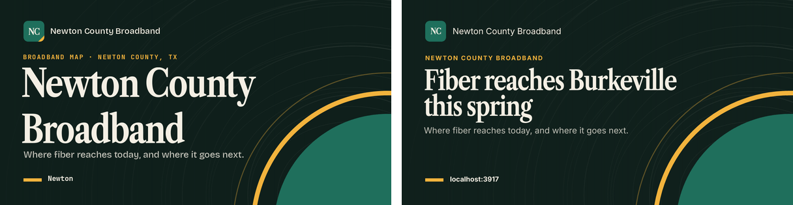
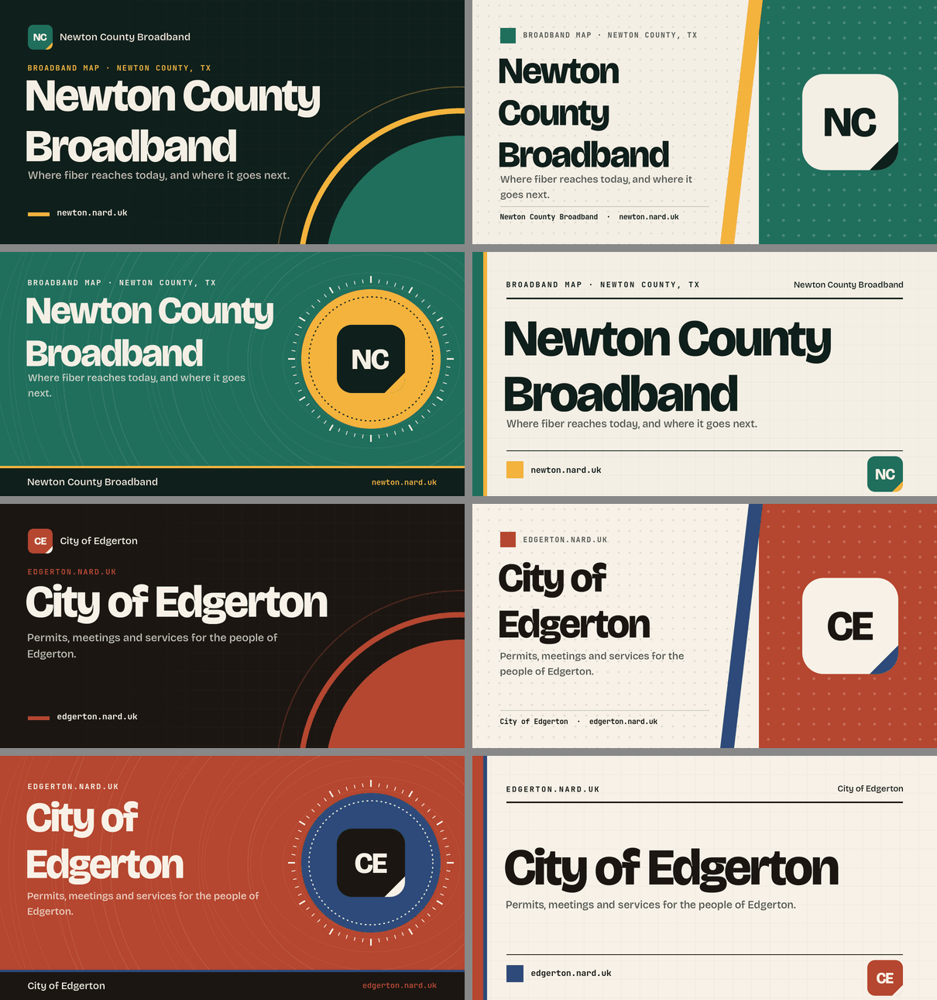

# Brand assets: favicons, app icons and the default share card

One file, `Config/brand.json` under the web app root, decides how an app looks
wherever it is bookmarked, installed or shared. `narduk-app assets generate`
draws the favicon set, the app icons, the web manifest and the default 1200×630
share card from it; `narduk-seo` reads the same file at build for the runtime
per-page card, the icon `<link>` tags and `theme-color`.
`narduk-app assets check` fails the build when any of it is missing or a
placeholder.

## Config/brand.json

```json
{
  "schemaVersion": 1,
  "name": "Newton County Broadband",
  "shortName": "Newton",
  "tagline": "Where fiber reaches today, and where it goes next.",
  "colors": {
    "primary": "#1f6f5c",
    "accent": "#f2b33d",
    "ink": "#0f1f1b",
    "paper": "#f4efe4"
  },
  "icon": "brand/app-icon.svg",
  "fonts": {
    "display": { "family": "Libre Caslon Condensed", "weight": 700 }
  },
  "og": {
    "layout": "poster",
    "pattern": "contours",
    "eyebrow": "Broadband map · Newton County, TX"
  }
}
```

| Key                            | Meaning                                                                                                                |
| ------------------------------ | ---------------------------------------------------------------------------------------------------------------------- |
| `name`, `shortName`, `tagline` | Card title, manifest `short_name` (default: the first word) and card subtitle.                                         |
| `colors`                       | `#rrggbb`. `primary` is the brand colour, `accent` the second, `ink` the darkest text and field, `paper` the lightest. |
| `themeColor`                   | Browser `theme-color` for light mode; default `primary`. Dark mode uses `ink`.                                         |
| `icon`, `iconMaskable`         | Optional square SVG or PNG (≥512 px) inside the app. Without one, the icon is a monogram tile.                         |
| `monogram`                     | 1-3 characters for the tile; default the name's initials.                                                              |
| `fonts.display`                | Optional display face for card titles, the monogram and the app's wordmark ([below](#display-font)).                   |
| `og.layout`                    | `poster`, `split`, `stamp` or `ledger` (below).                                                                        |
| `og.pattern`                   | `grid`, `dots`, `contours`, `diagonal` or `none`.                                                                      |
| `og.eyebrow`                   | Small mono label above the title; default the site host.                                                               |

`create-narduk-app` writes a starter file with one of ten contrast-checked
palettes and a layout picked from the app name, so two new apps do not look
alike. Replace it with the app's own art direction.

## Generate

```sh
pnpm exec narduk-app assets generate          # writes what is missing
pnpm exec narduk-app assets generate --force  # after editing brand.json
```

| File in `public/`                               | What                                                                                |
| ----------------------------------------------- | ----------------------------------------------------------------------------------- |
| `favicon.ico`                                   | Real multi-size ICO: 16, 32 and 48 px PNG entries.                                  |
| `favicon.svg`                                   | Scalable favicon; the monogram version carries a `prefers-color-scheme: dark` edge. |
| `favicon-32x32.png`                             | PNG favicon for clients that skip SVG.                                              |
| `apple-touch-icon.png`                          | 180 px, opaque, full bleed (iOS adds its own corners).                              |
| `icon-192.png`, `icon-512.png`, `icon-mask.png` | Manifest icons; `icon-mask.png` keeps the mark inside the maskable safe zone.       |
| `site.webmanifest`                              | Name, colours, `display: standalone` and the three icons.                           |
| `og.png` (or `defaultImage.path`)               | The default share card.                                                             |
| `fonts/brand-display.ttf`                       | The `fonts.display` face, when brand.json names one. Commit it.                     |

The card's type is bundled (Bricolage Grotesque and JetBrains Mono, OFL; see
`fonts/README.md`), so the same file renders the same card on any machine. A
title that would overflow is set smaller, never cropped mid-word. When
`Config/social-previews.json` names a `defaultImage.source`, that artwork is
used instead of the brand card.

## Display font

Without `fonts.display`, cards use the bundled display face. With it, the static
card, the runtime per-page card and the app all set display type in the app's
own face:

```json
"fonts": {
  "display": { "family": "Libre Caslon Condensed", "weight": 700, "style": "normal" }
}
```

| Key      | Meaning                                                                                                    |
| -------- | ---------------------------------------------------------------------------------------------------------- |
| `family` | The family as fonts.google.com names it.                                                                   |
| `weight` | 100-900 in steps of 100; default 700. Google Fonts must carry that exact weight.                           |
| `style`  | `normal` (default) or `italic`.                                                                            |
| `file`   | Optional static `.ttf` inside the app, for a face Google Fonts does not carry. No download when it is set. |



`assets generate` resolves the face once into `public/fonts/brand-display.ttf`
(a Google Fonts download, or a copy of `file`), and every surface reads that one
committed file, so builds and renders never need the network:

- **static card** (`og.png`): the title and the monogram.
- **runtime card** (narduk-seo `OgImageDefault`, `OgImageArticle`): narduk-seo
  adds an app stylesheet with an `@font-face` for the file, which nuxt-og-image
  loads; the title and monogram use it.
- **the app**: the same stylesheet sets `--brand-font-display` on `:root`, so a
  wordmark is `font-family: var(--brand-font-display)`.

`generate` keeps an existing file; pass `--force` after changing the face. When
the face cannot be resolved (a misspelt family, a weight Google Fonts does not
have, no network), `generate` warns, the card falls back to the bundled face,
and `assets check` fails until the file exists. Use a static instance: a
variable font draws its default weight, not `weight`, and `check` rejects it.
The favicon SVG keeps a system font stack; its PNG icons use the face.

On macOS the card renderer (libvips) would ignore font files and draw Helvetica;
`narduk-app` sets `PANGOCAIRO_BACKEND=fc` and a minimal `FONTCONFIG_FILE` before
rendering, and leaves either alone when already set.

## Layouts



- **poster**: ink field, texture, a primary disc with accent rings; huge title.
- **split**: paper text column, primary panel holding the mark (or the page's
  own image at runtime).
- **stamp**: primary field, an accent seal around the mark, an ink sign-off
  band.
- **ledger**: editorial paper sheet between two rules, the widest title.

## Check

```sh
pnpm exec narduk-app assets check                  # offline, the checkout
pnpm exec narduk-app assets check --live           # the deployed siteUrl
pnpm exec narduk-app assets check --live https://example.com --json report.json
```

Both exit 1 with one line per problem. The offline check fails when:

- a favicon file, the apple-touch icon, the manifest or a manifest icon is
  missing;
- `favicon.ico` is a placeholder (a few bytes, a `data:` URI or HTML), not an
  ICO, lacks the 16/32/48 entries, or is one flat colour;
- the apple-touch icon is not 180×180 or has transparent pixels;
- the manifest lacks `name`, colours, `display`, a 192, a 512 or a maskable
  icon, or an icon's real size differs from its declared one;
- the share card is missing, not 1200×630, one flat colour, a known placeholder,
  or the legacy generic create-narduk-app card (recoloured copies included);
- brand.json names `fonts.display` and `fonts/brand-display.ttf` is missing, not
  a TrueType/OpenType font, or a variable font.

`--live` also reads the page head: it fails without `<link rel="icon">`, an SVG
icon, `<link rel="apple-touch-icon">`, `<link rel="manifest">`,
`<meta name="theme-color">` or `og:image`, then fetches and checks each file.

Generated apps run `assets generate --if-missing`, `og:check` and `assets check`
before `nuxt build`, so a build without a real icon set and card fails.

## Existing apps

`narduk-app upgrade` does not rewrite an app's `build` script. To adopt:

1. Add `apps/web/Config/brand.json`.
2. Remove `defaultImage.source` from `Config/social-previews.json` if it points
   at the old generated `og-source.svg`, and delete that file.
3. `pnpm exec narduk-app assets generate --force` in `apps/web`, review, commit
   `public/`.
4. Add `narduk-app assets check` to `build` and `cf:build` after `og:check`.
5. Deploy, then `pnpm exec narduk-app assets check --live`.

With `narduk-seo`, the icon links and `theme-color` are emitted automatically
for the files that exist; see its README for `nardukSeo.brand` and
`nardukSeo.icons`.
